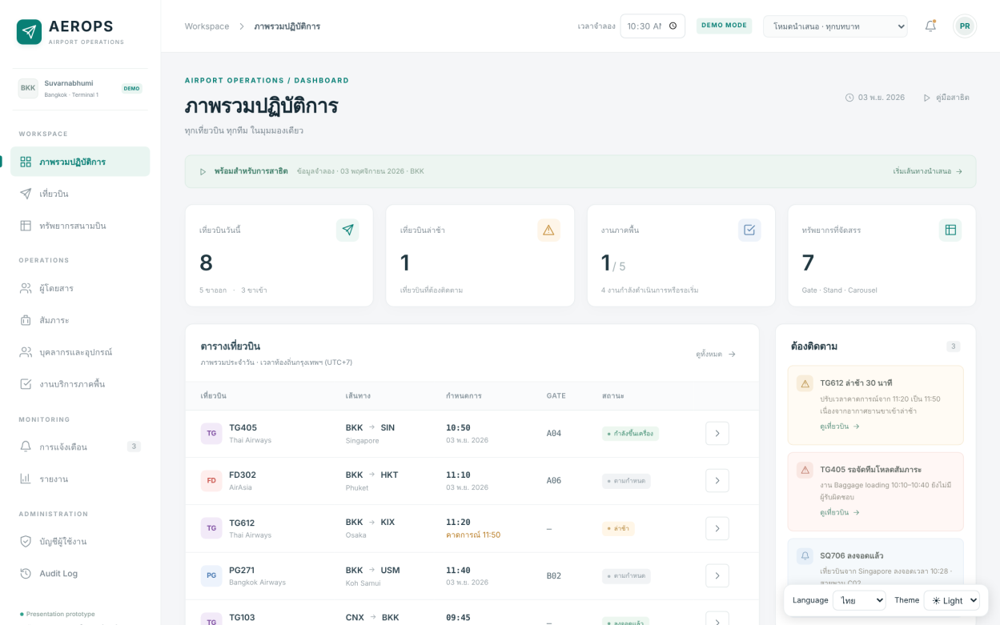
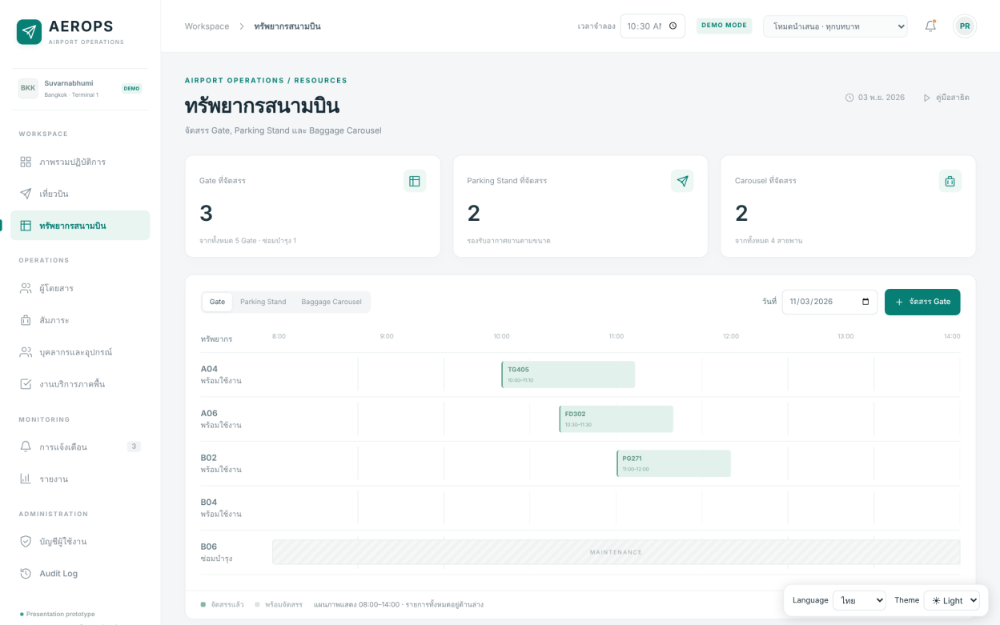

# AEROPS — Airport Operations Management System

A five-member course project for **ITDS262 Software Engineering Lab**, Faculty of Information and Communication Technology, Mahidol University (2026).

| Team member |
| --- |
| ญาณวุฒิ ทองยัง |
| ดนยกฤตย์ ภัทร์ธนะวัตน์ |
| นรบดี ศรีดีเลิศ |
| ศุภวิชญ์ ธรรมราษฎร์ |
| ภควรรษ ลิโมทัย |

## About the project

AEROPS explores how airport staff could coordinate daily operations in one system: manage flights, allocate gates and other resources, track baggage, and organize ground-handling tasks.

The project includes requirements documentation, use case modeling, data flow diagrams, test cases, and an interactive web prototype that demonstrates the proposed workflows.

## What's included

- **Requirements:** functional and non-functional requirements, actors, and responsibilities.
- **System models:** use case diagrams and narratives, functional decomposition, and DFD Levels 0–2.
- **Prototype:** flight management, resource allocation, passenger and baggage records, personnel and equipment, ground handling, notifications, reports, and audit logs.
- **Test cases:** normal and invalid-input scenarios for gate allocation, baggage registration, and flight creation.

## My contribution

This repository presents our team's coursework as part of my portfolio. I created the use case diagrams and contributed to reviewing data flow diagrams for consistency with system requirements. Other project deliverables were developed collaboratively by the team.

## Run the prototype

Open [`index.html`](index.html) in a browser. No installation or build step is required.

The prototype uses **HTML, CSS, and JavaScript**, with sample data saved in browser `localStorage`. Select a demo role to explore the screens. Authentication and permissions are simulated; there is no live backend, database server, or connection to real airport systems. Browser data is not shared between users or devices.

## Deploy on Vercel

Import this GitHub repository into Vercel and use:

| Setting | Value |
| --- | --- |
| Framework Preset | Other |
| Root Directory | Repository root |
| Build Command | No build command |
| Output Directory | `public` |

The `public/` directory contains the same prototype as the root `index.html`. No environment variables are needed. Supporting reports and presentation files remain outside the deployed site.

## AI assistance

As disclosed in the project report, the team used Claude to assist with brainstorming, drafting, diagram consistency reviews, documentation, and prototype code. The team defined the requirements and drafted the diagrams, then reviewed and tested the resulting work.
