# AEROPS — Airport Operations Management System

A five-member course project for **ITDS262 Software Engineering Lab**, Faculty of Information and Communication Technology, Mahidol University (2026).

**[Try the interactive prototype](https://aerops-system-design.vercel.app/)**

| Team member |
| --- |
| ญาณวุฒิ ทองยัง |
| ดนยกฤตย์ ภัทร์ธนะวัตน์ |
| นรบดี ศรีดีเลิศ |
| ศุภวิชญ์ ธรรมราษฎร์ |
| ภควรรษ ลิโมทัย |

## About the project

AEROPS explores how airport staff could coordinate daily operations in one system: manage flights, allocate gates and other resources, track baggage, and organize ground-handling tasks.

The project includes requirements documentation, use case modeling, data flow diagrams, test cases, and an interactive web prototype that demonstrates the proposed workflows.

## What's included

- **Requirements:** functional and non-functional requirements, actors, and responsibilities.
- **System models:** use case diagrams and narratives, functional decomposition, and DFD Levels 0–2.
- **Prototype:** flight management, resource allocation, passenger and baggage records, personnel and equipment, ground handling, notifications, reports, and audit logs.
- **Test cases:** normal and invalid-input scenarios for gate allocation, baggage registration, and flight creation.

## Project walkthrough

Selected pages from the team's report show how the system was analyzed, modeled, and demonstrated. Expand each section to view the work; click an image to enlarge it.

<strong>1. Functional and non-functional requirements (FR / NFR)</strong>

Functional requirements describe what users can do. Non-functional requirements define quality expectations such as performance, security, and usability. The FR table below is an excerpt from the 62 functional requirements.

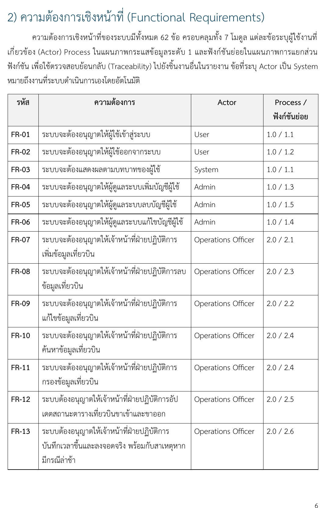

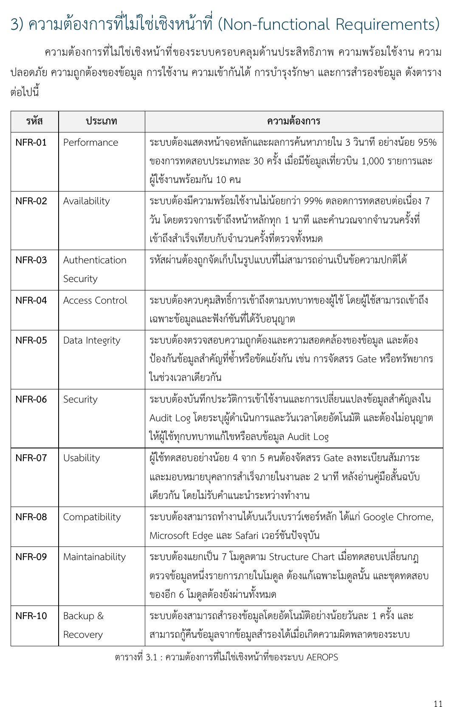

<strong>2. Use case diagrams</strong>

The diagrams map airport staff roles to the actions they perform in the proposed system.

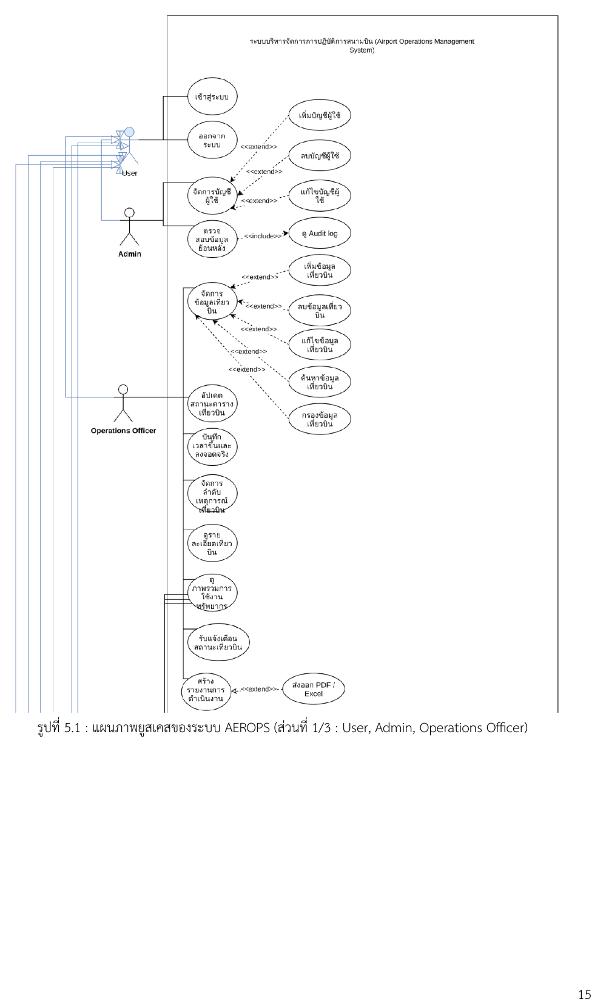

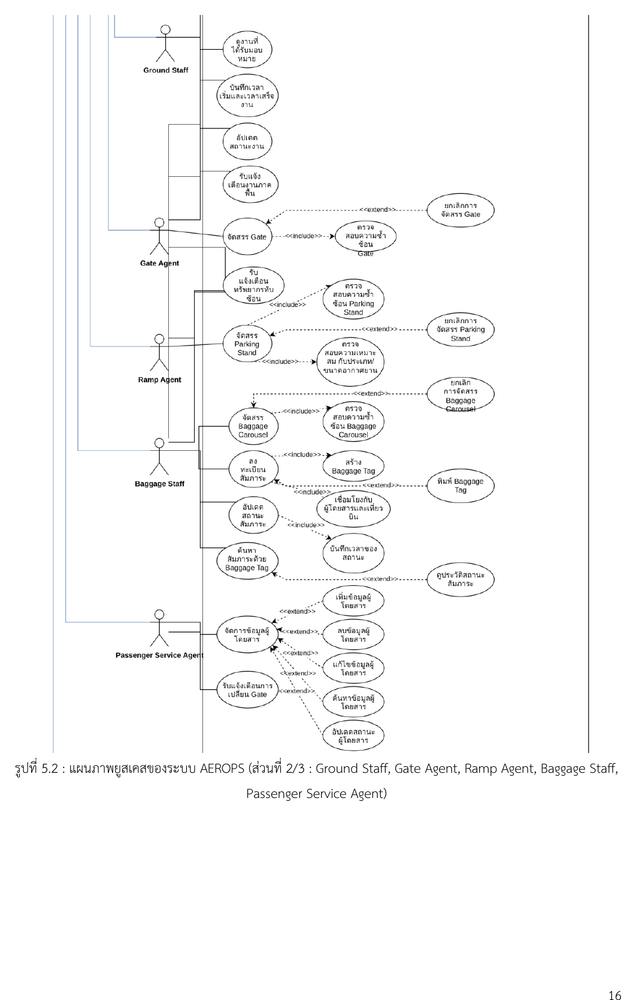

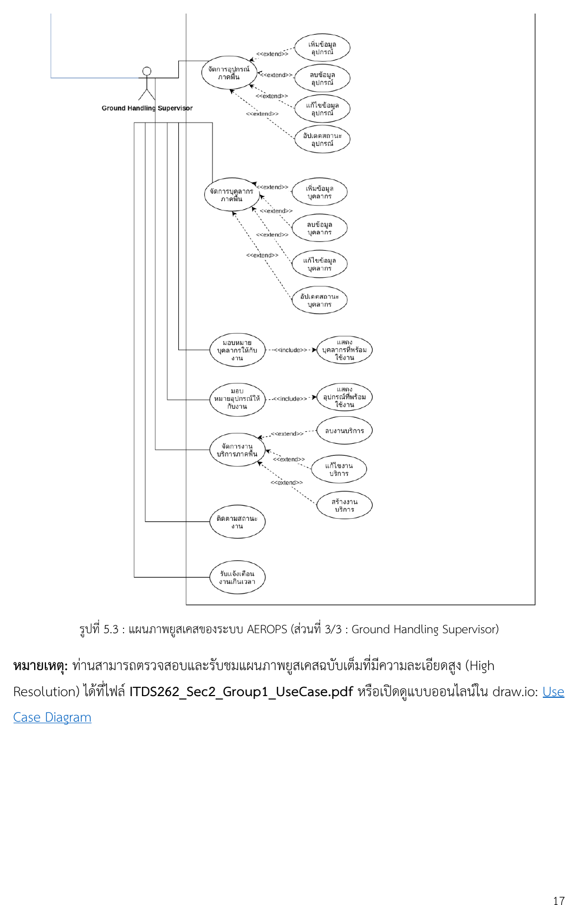

<strong>3. Use case narrative</strong>

The gate allocation example describes preconditions, the main flow, alternative and exception flows, and the resulting system state.

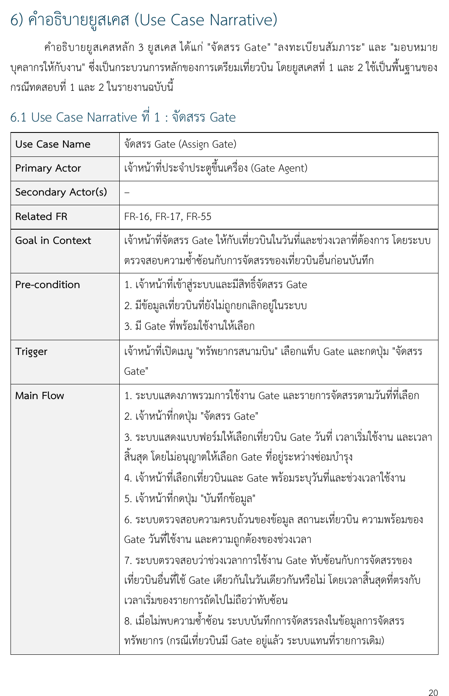

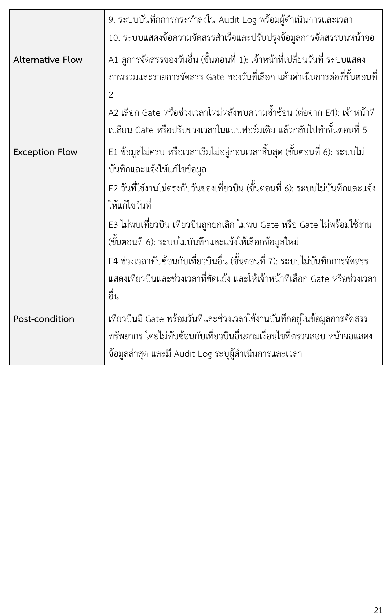

<strong>4. Functional decomposition (Structure Chart)</strong>

A hierarchy breaks the proposed system into seven main modules and their smaller functions.

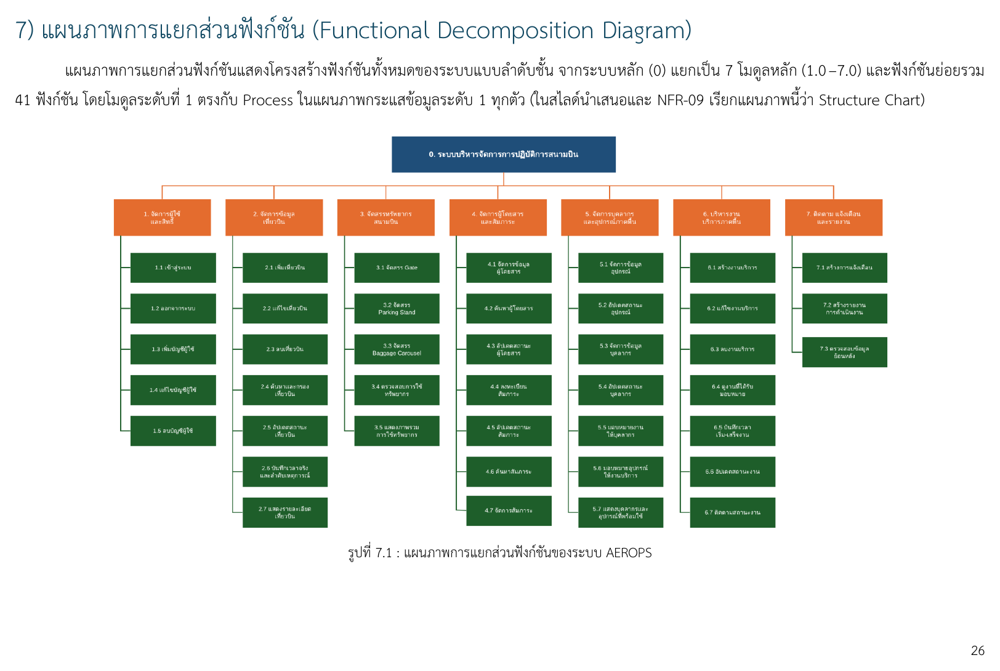

<strong>5. Data flow diagrams — Levels 0, 1, and 2</strong>

Level 0 shows the system boundary and external actors. Level 1 separates the main processes and data stores. Level 2 expands flight management, resource allocation, and ground handling.

**Level 0 — Context diagram**

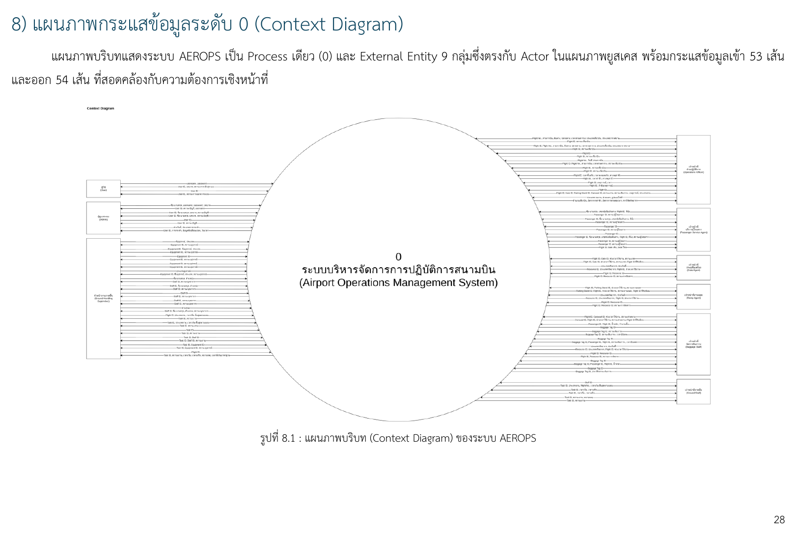

**Level 1 — Main processes**

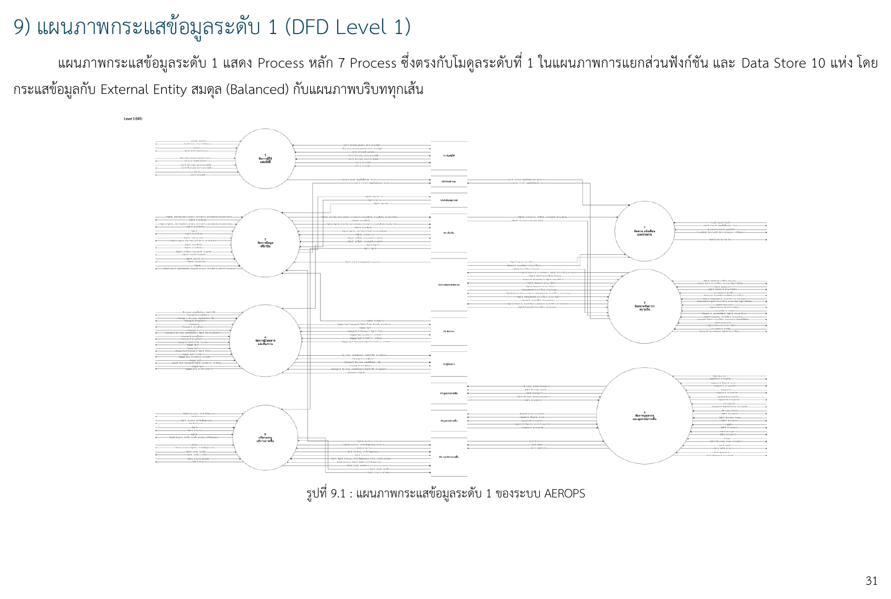

**Level 2 — Detailed processes**

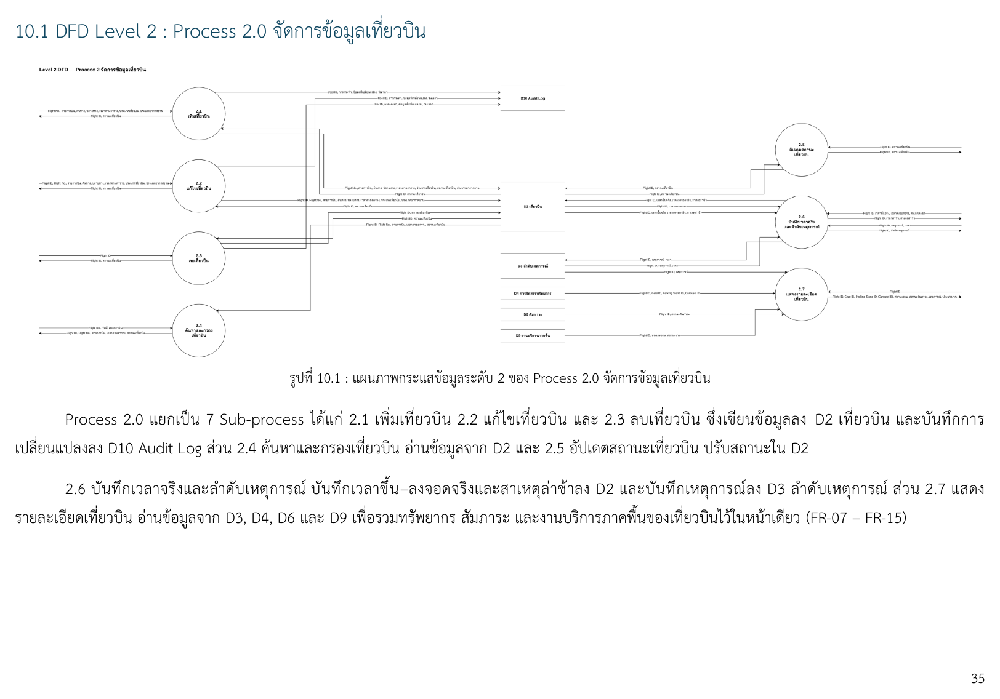

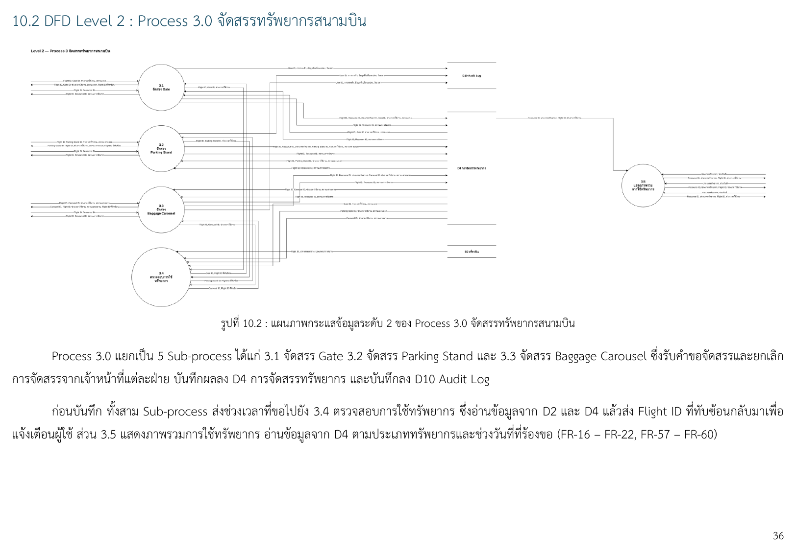

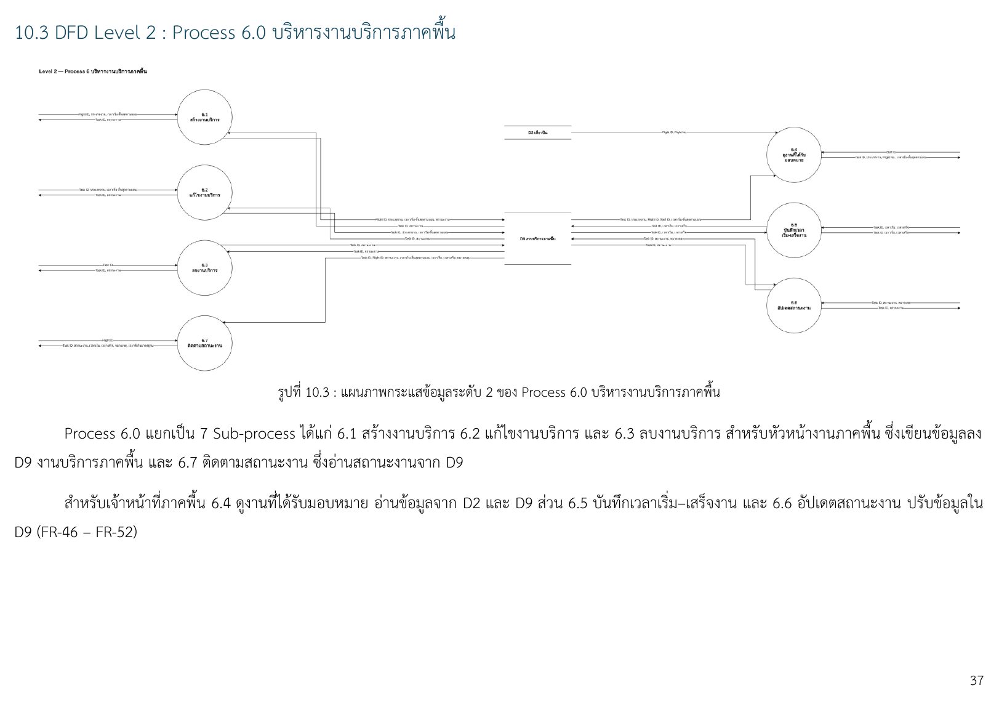

### Interactive prototype

The prototype demonstrates the proposed screens and workflows using sample data. [Open the live demo](https://aerops-system-design.vercel.app/).

<strong>6. Test case example</strong>

The gate allocation test records preconditions, input data, steps, expected and actual results, and the reported test status. The project also documents invalid-input scenarios.

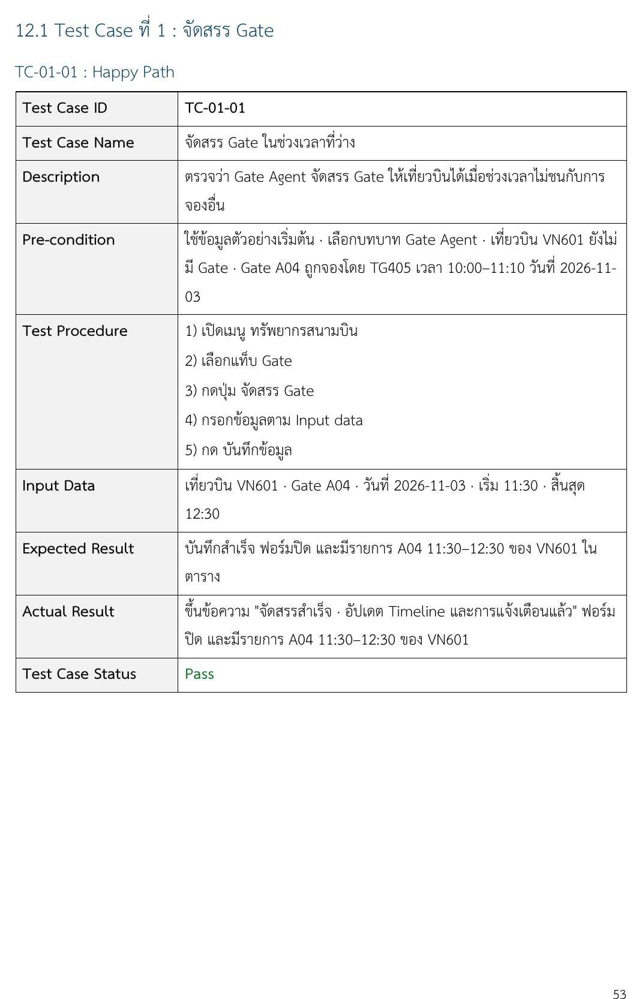

## My contribution

This repository presents our team's coursework as part of my portfolio. I created the use case diagrams and contributed to reviewing data flow diagrams for consistency with system requirements. Other project deliverables were developed collaboratively by the team.

## Run the prototype

Open [`index.html`](index.html) in a browser. No installation or build step is required.

The prototype uses **HTML, CSS, and JavaScript**, with sample data saved in browser `localStorage`. Select a demo role to explore the screens. Authentication and permissions are simulated; there is no live backend, database server, or connection to real airport systems. Browser data is not shared between users or devices.

## AI assistance

As disclosed in the project report, the team used Claude to assist with brainstorming, drafting, diagram consistency reviews, documentation, and prototype code. The team defined the requirements and drafted the diagrams, then reviewed and tested the resulting work.
